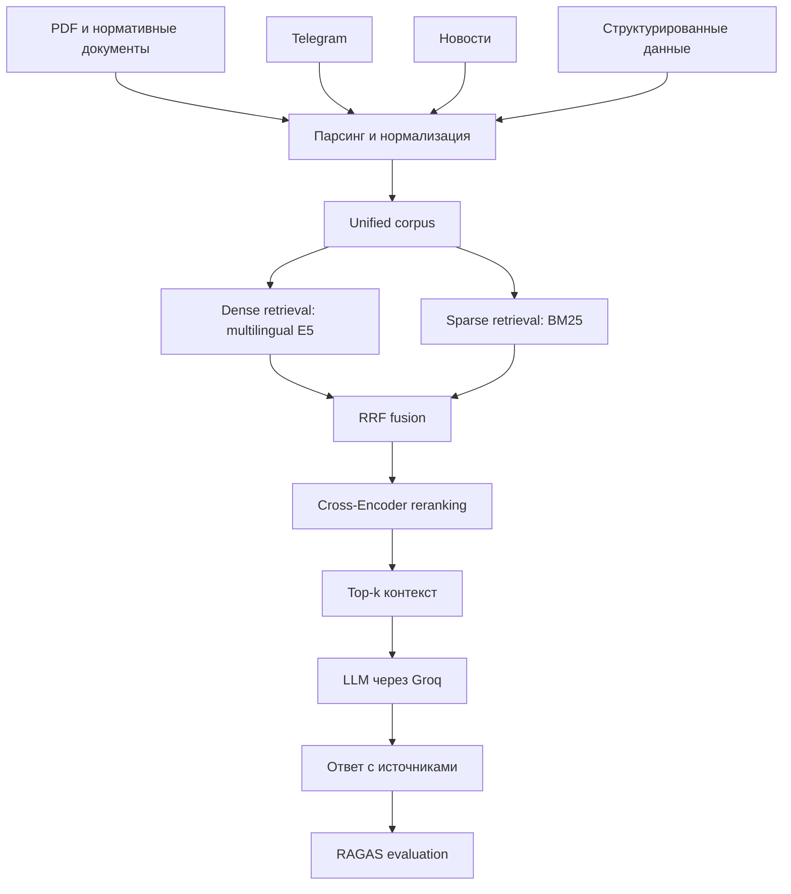

# FinRAG — гибридная RAG-система для финансовой и нормативной аналитики

FinRAG — RAG-система для поиска и генерации ответов по разнородным финансовым, новостным и нормативным источникам. Проект охватывает полный цикл: подготовку данных, гибридный retrieval, neural reranking, генерацию ответов с источниками и экспериментальную оценку качества.


## Задача проекта

Построить RAG, который будет выполнять весь функционал: от нахождения доказательных фрагментов в разнородном корпусе, объединение результатов разных поисковых методов и переупорядочивание кандидатов до передачи LLM ограниченный контекст и измерения качества результата. 
## Возможности

- Обработка PDF и нормативных документов, Telegram-сообщений, новостных публикаций и структурированных финансовых данных.
- Формирование унифицированного корпуса.
- Dense retrieval на основе multilingual E5 и sparse retrieval через BM25.
- Объединение ранжированных списков с помощью Reciprocal Rank Fusion (RRF).
- Neural reranking с использованием Cross-Encoder.
- Генерация ответов через Groq API с контекстом из top-k документов и ссылками на источники.
- Раздельная оценка retrieval и generation, включая ablation-тест reranker/no-reranker.

## Архитектура



## Корпус

Текущий подготовленный корпус содержит **188 474 записи/фрагмента**:

| Источник | Количество |
|---|---:|
| Новости | 91 090 |
| PDF / нормативные документы | 36 202 |
| Telegram | 31 182 |
| Структурированные данные | 30 000 |
| **Всего** | **188 474** |

## Конфигурация эксперимента

| Компонент | Настройка |
|---|---|
| Embeddings | `intfloat/multilingual-e5-base` |
| Sparse retrieval | BM25 |
| Fusion | Reciprocal Rank Fusion |
| Reranker | BGE Cross-Encoder (`BAAI/bge-reranker-v2-m3` в базовой конфигурации) |
| Dense candidates | 100 |
| Sparse candidates | 100 |
| Reranker candidates | 50 |
| Контекст генерации | top-5 фрагментов |
| Ограничение на документ | 4 500 символов |
| Генератор | `openai/gpt-oss-20b` через Groq API |
| Лимит completion | 1 200 токенов |

В `no_reranker` Cross-Encoder отключён, остальные настройки retrieval и generation сохранены. 

## Fine-tuning reranker

Реализован полный цикл fine-tuning кросс-энкодера BAAI/bge-reranker-v2-m3, включающий генерацию обучающих данных, подбор hard-negative примеров, разбиение на выборки, обучение модели и оценку качества на основе бенчмарков.

Основные этапы:

1) Генерация синтетических поисковых запросов на основе документов из корпуса (случайно выбираемые документы передавались в внешнюю LLM с использованием GROQ API KEY с промптом: сгенерируй вопрос по данном документу).

2) Для сгенерированных запросов использовались как случайные негативы (из корпуса выбиралось 3 случаных документа и они проверялись LLM на факт того, что они дейтсвительно не отвечают на запрос), так и hard-negatives(запускали нашу систему поиска, включая reranker, он возвращал 10 документов по данному запросу и они подавались в LLM на проверку, и те <= 5 документов, которые оказывались нерелевантными, входили в состав негативов)
   
3) Формирование пар «запрос — документ» (положительных и отрицательных).

4) Дообучение кросс-энкодера с использованием библиотеки Sentence Transformers.

5) Сравнительная оценка качества 2 моделей: до и после fine-tune реранкера.

## Результаты

### Отдельный retrieval-only эксперимент

На тестовой выборке retrieval-эксперимент дал следующие результаты:

| Конфигурация | Recall@10 | MRR@10 | nDCG@10 |
|---|---:|---:|---:|
| Fine-tuned BGE reranker | **1.000** | **0.911** | **0.927** |
| Based BGE reranker | 1.000 | 0.851 | 0.882 |
| Без reranker | 0.857 | 0.631 | 0.682 |


### Generation + RAGAS ablation

Для сравнения эффекта reranker провели тест RAGAS.
| Метрика | `full` | `no_reranker` | Разница |
|---|---:|---:|---:|
| Faithfulness | 1.000 | 0.861 | +0.139 |
| Context Precision | 0.917 | 0.481 | +0.435 |
| Context Recall | 1.000 | 0.833 | +0.167 |
| Factual Correctness (F1) | 0.473 | 0.278 | +0.195 |
| Answer Relevancy | 0.885 | 0.741 | +0.144 |


Средняя измеренная задержка retrieval на этих же вопросах:

| Конфигурация | Среднее время retrieval |
|---|---:|
| `full` | 7,69 с |
| `no_reranker` | 2,66 с |

Reranker улучшил ранжирование, но увеличил время поиска. Однако, отмечу, что задержка зависит от оборудования и режима выполнения, поэтому не является стоп-фактором для внедрения reranker.

### Ограничения эксперимента

- RAGAS использует LLM-as-a-judge.
- Context Precision и Context Recall оценивают текстовые контексты, а не прямое совпадение.
- Factual Correctness сравнивает ответ с reference; неполный эталон может штрафовать корректные дополнительные факты.

## Структура проекта

```text
FinRAG/
│
├── README.md
├── PUBLIC_DATA_NOTICE.md
├── GITHUB_RELEASE_CHECKLIST.md
├── .gitignore
├── .env.example
│
├── data_parser.py                  # парсинг источников и подготовка
├── index_data_refactored.py        # построение векторного индекса
├── retrieval.py                    # dense + BM25 + RRF + reranking
├── generation.py                   # подготовка контекста и генерация
│
├── evaluation/
│   ├── __init__.py
│   ├── build_baseline_dataset.py
│   ├── compare_evaluations.py          #сравнение моделей
│   ├── compile_reviewed_benchmark.py
│   ├── evaluate_baseline.py            # retrieval evaluation
│   ├── evaluate_ragas_ablation.py      # generation + RAGAS ablation
│   ├── generate_annotation_drafts.py
│   ├── generate_reranker_synthetic.py  # генерация вопроса и документа с LLM
│   ├── mine_reranker_negatives.py      # негативы для fine-tune reranker
│   ├── reranker_data_utils.py
│
└── training/
    ├── __init__.py
    └── finetune_reranker.py
```


## Запуск эксперимента

```bash
# Генерация ответов на весь test split
python evaluation/evaluate_ragas_ablation.py --phase generate --limit 0

# Оценка сохранённых ответов через RAGAS
python evaluation/evaluate_ragas_ablation.py --phase score --limit 0
```

Результаты сохраняются в `evaluation/results/ragas_ablation/`. Генерации записываются инкрементально, поэтому повторная оценка не требует повторного запуска генератора.

## Конфигурация и секреты

Для доступа к Groq задайте переменную окружения или локальный `.env`:

```bash
GROQ_API_KEY=your_groq_api_key
```

## Направления исследования

- Гибридный семантический и лексический поиск.
- Объединение поисковых ранжирований и Cross-Encoder reranking.
- Выбор evidence-контекста для LLM.
- Генерация ответов с источниками.
- Раздельная оценка retrieval и generation.
- Компромисс между качеством ответа, задержкой и токенным бюджетом.


